# Pagine principali e introduzione — 25 ottobre 2026

La revisione completa le superfici raggiungibili dalle quattro schede, mantenendo il marketplace e la panoramica Schermate appena verificati. Prima non esisteva un onboarding: la ricerca nei sorgenti non trovava un flusso né uno stato di completamento.

## 1. Apertura e dispositivo

**Home:** eliminati il titolo promozionale molto alto e il secondo pannello che ripeteva il collegamento. Un’unica scheda mostra stato, anteprima compatta, tema e numero di schermate; la personalizzazione è l’azione principale. La dicitura Anteprima distingue il disegno dai dati live. Luminosità, misure e aggiornamenti hanno descrizioni brevi e una freccia di navigazione.

**Collegamento:** istruzioni essenziali, ricerca avviata solo dal pulsante e stato vuoto corretto prima del primo tentativo. Prima la pagina dichiarava Nessun dispositivo trovato anche senza aver cercato. Nessuna richiesta Bluetooth parte dal lancio o dall’introduzione.

**Luminosità:** selezione Automatica/Manuale visibile, livello con percentuale leggibile, un salvataggio contestuale. Con testo di accessibilità il selettore diventa un menu. Le azioni non pertinenti non restano in primo piano come pulsanti disabilitati.

**Misure:** nomi leggibili, simboli familiari e unità secondarie; conteggio e accesso diretto alla personalizzazione. La ricerca nativa si espande quando serve.

**Aggiornamenti:** stato e versione in una scheda, una sola azione principale per ogni fase e avanzamento durante download/installazione. Il flusso dimostrativo mantiene gli identificatori e la stessa macchina a stati. Il percorso da file conserva tutti i controlli di verifica e trasferimento; le scelte dei file diventano righe uniche e le fasi sono numerate. La conferma di installazione usa azioni esplicite.

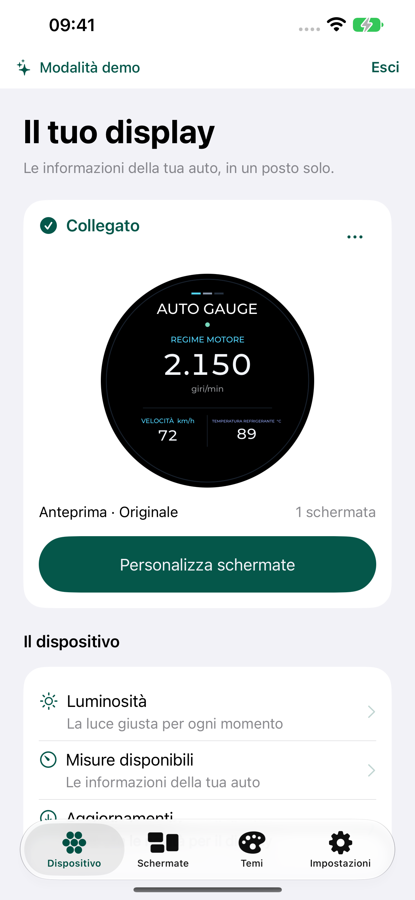
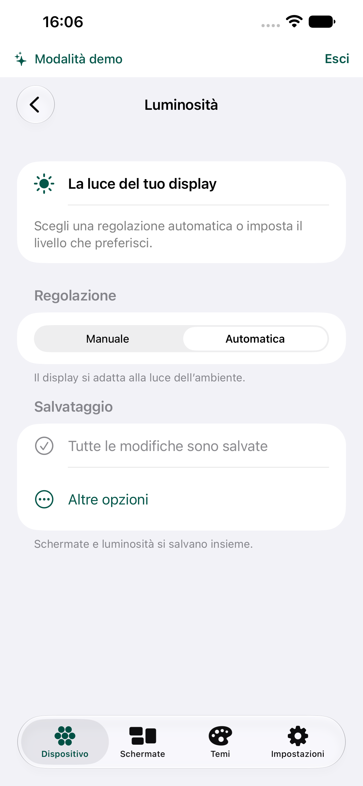
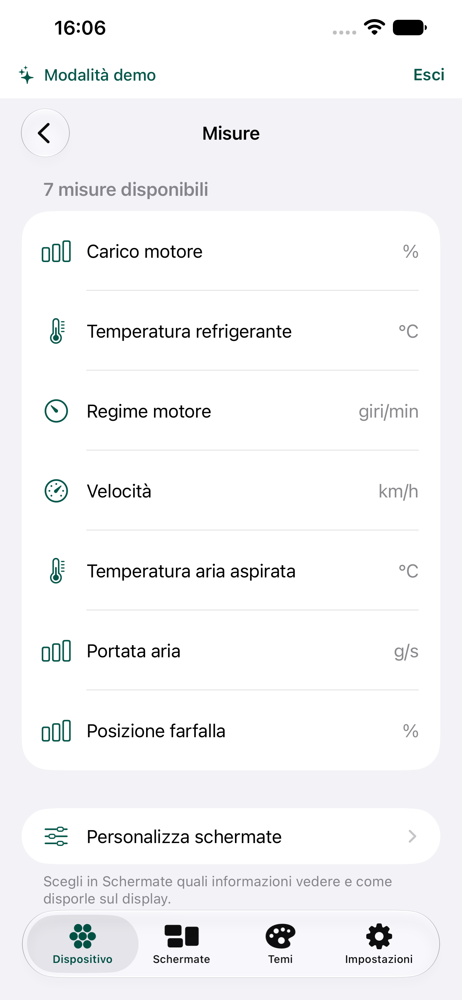
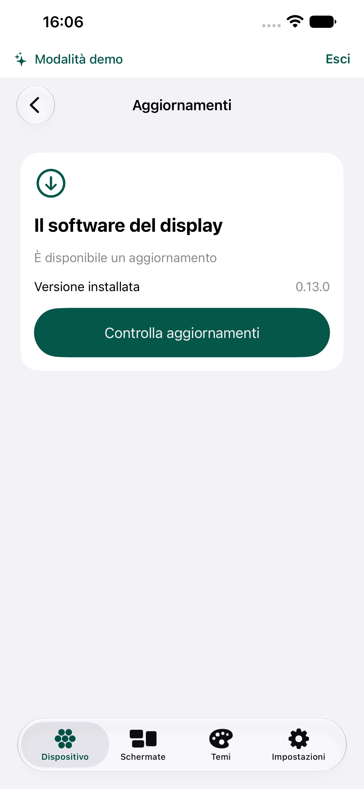
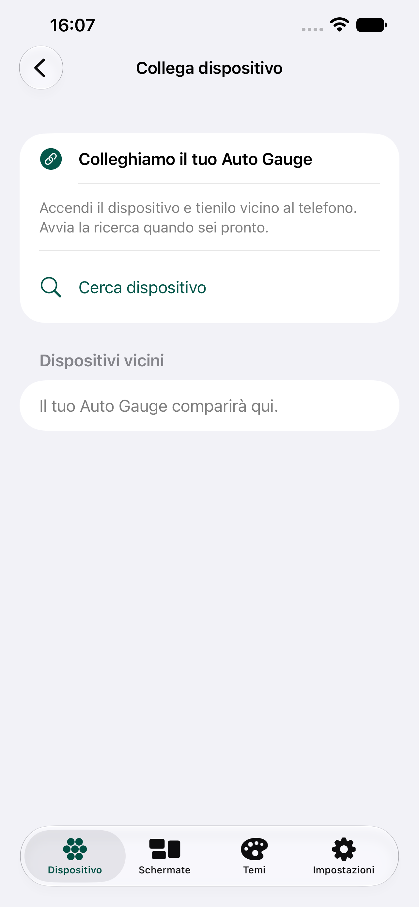

## 2. Preferenze e personalizzazione

**Impostazioni:** raggruppamenti Aspetto, I tuoi temi, Esplora l’app e Primi passi. Automatico spiega che segue il telefono. Il pulsante richiesto **Rivedi introduzione** avvia il flusso senza cancellare dati o azzerare la preferenza di completamento; è il comando temporaneo di prova di questa versione.

**Editor delle schermate:** anteprima ridotta a 240 pt, istruzioni riunite in un solo elemento e misure raggiungibili prima. Le regolazioni precise restano espandibili. Il salvataggio condiviso con Luminosità mostra le azioni quando servono; annullamento e ripristino hanno conferme esplicite.

**Creatore del tema:** anteprima compatta, selettori di colore nativi e azione principale con contrasto adattivo. La creazione resta gratuita e non modifica la proprietà dei prodotti a pagamento.

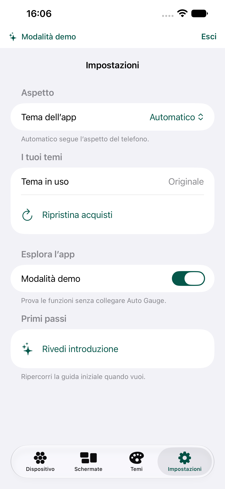
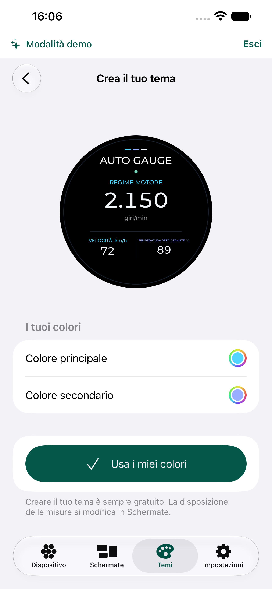
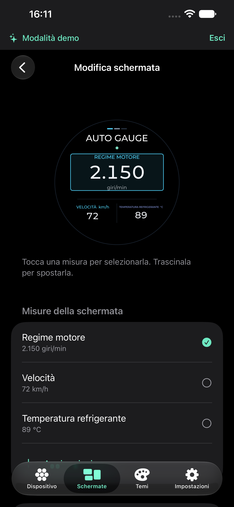

## 3. Primo avvio e ripetizione

Tre passaggi, tutti saltabili:

1. **Benvenuto:** scopo dell’app e anteprima del display.
2. **Prova uno stile:** Essenziale, Pixel e Neon cambiano soltanto l’anteprima locale. Non acquistano temi e non cambiano il tema salvato. Con testo di accessibilità il selettore diventa un menu.
3. **Inizia:** Collega Auto Gauge porta alla modalità dispositivo; Prova senza dispositivo entra nella demo. L’avvio della ricerca resta un’azione separata e volontaria. Nessuna richiesta di account o pagamento.

Il completamento, anche tramite Salta, persiste in `onboarding.completed.v1`. La guida non riappare ai lanci successivi, ma si può rilanciare dalle Impostazioni. Le installazioni aggiornate che non hanno ancora questo indicatore vedranno la guida una volta. Salta lascia la modalità corrente; la scelta esplicita della modalità usa il percorso esistente che conserva separatamente gli stati demo e dispositivo.

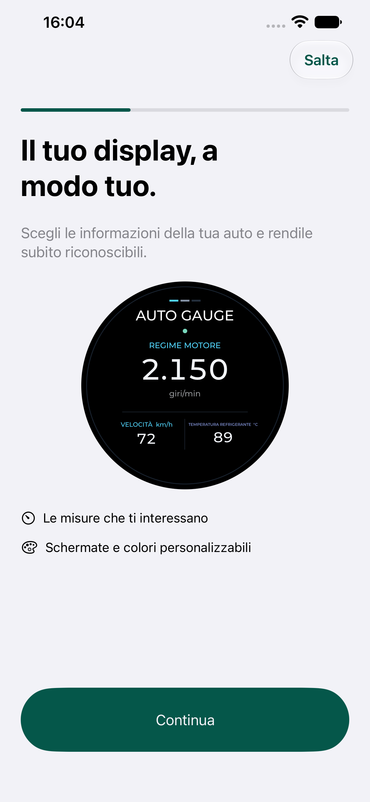
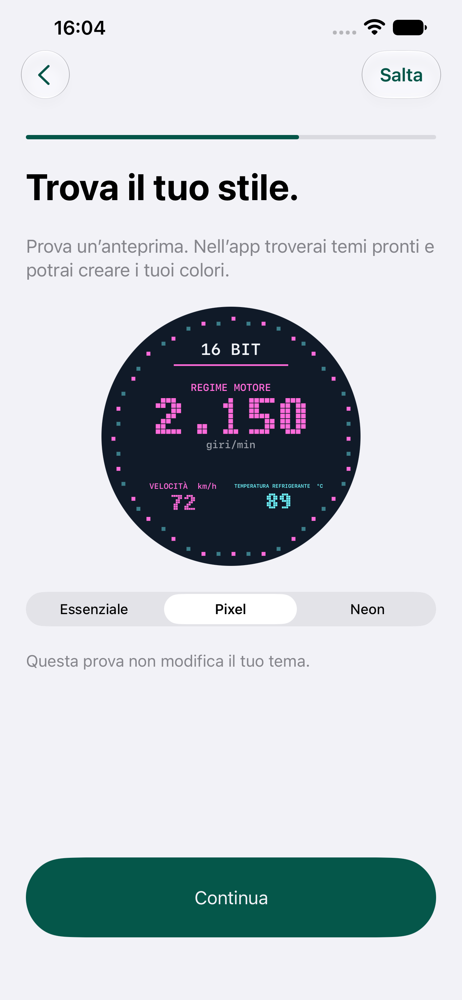
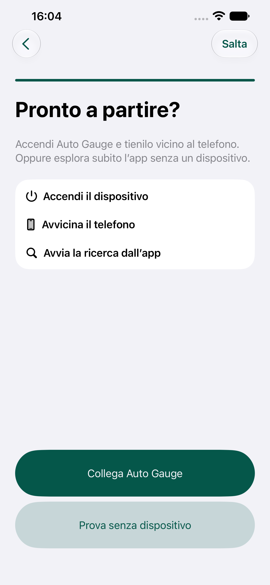

## Indicazioni e limiti della verifica

Le scelte seguono le indicazioni Apple su [Onboarding](https://developer.apple.com/design/human-interface-guidelines/onboarding): percorso breve e opzionale, apprendimento interattivo, richieste di permesso legate a un’azione e possibilità di rivedere l’introduzione. [Buttons](https://developer.apple.com/design/human-interface-guidelines/buttons) orienta gerarchia e aree toccabili; [Collections](https://developer.apple.com/design/human-interface-guidelines/collections) orienta le liste. La forma specifica delle pagine è una scelta applicata ad Auto Gauge.

Le sette immagini precedenti in `before/` sono state catturate e ispezionate all’inizio di questa revisione, da `/tmp/ag-allpages-before.xcresult`. Le immagini finali provengono dai test della stessa revisione e sono elencate in `screenshots.json`. Le etichette e i testi esterni al disegno del quadrante seguono Dynamic Type; le conferme hanno azioni esplicite e i colori usano la stessa palette adattiva. I test e gli screenshot non dimostrano piena conformità: navigazione completa con VoiceOver e valutazione da parte di persone con esigenze diverse restano verifiche manuali.

La verifica reale del trasferimento firmware richiede hardware e configurazione compatibili: in questa revisione non è stato trasferito o installato firmware su un display. Il percorso manuale è stato verificato nei sorgenti e nella compilazione, senza modificarne i requisiti di sicurezza. Gli acquisti reali dei temi mantengono il gate disabilitato.

## Esito finale

1. **Apertura e dispositivo — verificati:** percorso fra le cinque pagine in chiaro e scuro, luminosità manuale con persistenza e annullamento, aggiornamento dimostrativo completo.
2. **Preferenze e personalizzazione — verificati:** aspetto persistente, creazione del tema, apertura dell’editor e lettura dei dati già salvati. I testi nei collegamenti usano colori semantici espliciti per evitare che le descrizioni ereditino una tinta poco leggibile.
3. **Introduzione — verificata:** tre passaggi, anteprima interattiva, salto con testo di accessibilità, scelta della modalità, completamento persistente e ripetizione dalle Impostazioni. Concludere una ripetizione torna alla home anche se non si cambia modalità; Salta lascia nella pagina da cui si è avviata.

Sono passati **11 test del modello** (`/tmp/ag-experience-model.log`) e **18 test UI** (`/tmp/ag-experience-final2-ui.xcresult`). Dopo le ultime correzioni di navigazione e colore sono stati ripetuti quattro scenari in scuro, tutti passati (`/tmp/ag-experience-dark-ui.xcresult`). I risultati non sono test di installazione firmware sul dispositivo fisico.

La build firmata è stata installata e avviata sul vero iPhone 13 Pro Max (`/tmp/ag-experience-final-iphone-build.log`, `/tmp/ag-experience-final-iphone-install.log`, `/tmp/ag-experience-iphone-launch.log`). Il simulatore principale è aggiornato e avviato con le preferenze ordinarie; quello usato per i test resta separato. I dettagli di provenienza, inclusa la cattura finale della home chiara, sono in `screenshots.json`.
