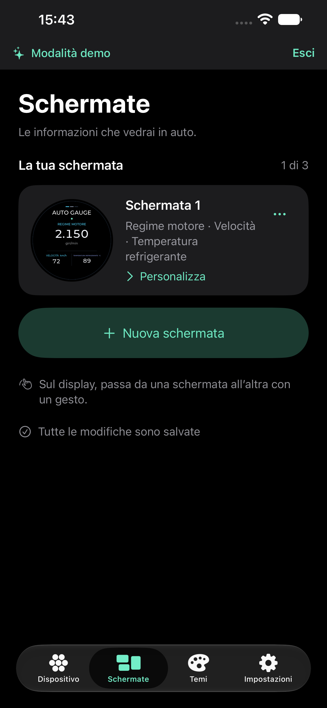
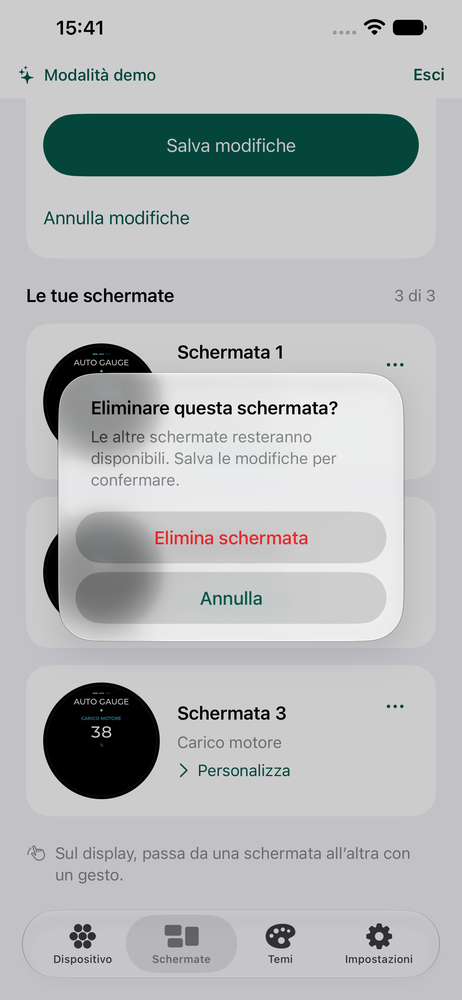

# Schermate — revisione del 25 ottobre 2026

## Percorso e motivi della modifica

1. **Panoramica.** La versione precedente mostrava un quadrante quasi a tutta pagina, titolo ripetuto e un grande pulsante Modifica per ogni elemento. L’aggiunta e il riepilogo del salvataggio finivano sotto la prima schermata. La nuova panoramica usa righe compatte con miniatura, nomi delle misure e accesso diretto Personalizza. Il conteggio rende visibile il limite di tre schermate; l’aggiunta scompare quando il limite è raggiunto. I controlli secondari restano nel menu di ciascuna riga.
2. **Modifica e conferma.** Il pannello Salva modifiche compare vicino all’inizio solo quando ci sono modifiche da confermare. Annullamento ed eliminazione chiedono conferma, senza azioni distruttive mescolate all’azione principale. L’editor conserva il quadrante completo e raccoglie le regolazioni precise in una sezione espandibile. Colori, temi, misure, protocollo e persistenza mantengono il comportamento esistente.

Le scelte applicano le indicazioni Apple su [Collections](https://developer.apple.com/design/human-interface-guidelines/collections) (righe standard, selezione semplice, gerarchia stabile), [Buttons](https://developer.apple.com/design/human-interface-guidelines/buttons) (poche azioni prominenti, etichette chiare, aree di almeno 44 pt) e [Alerts](https://developer.apple.com/design/human-interface-guidelines/alerts) (conferma di scelte con conseguenze distruttive). La disposizione specifica è una scelta progettuale per un catalogo di massimo tre schermate.

## Accessibilità e limiti

Con caratteri di accessibilità, miniatura e testo passano da orizzontali a verticali; i nomi delle misure non vengono troncati. Le miniature sono decorative: VoiceOver riceve nome della schermata, misure e azione. Menu e pulsanti hanno etichette e aree di almeno 44 pt. Il quadrante è una rappresentazione in scala del display, mentre le informazioni testuali accanto seguono Dynamic Type. Le immagini e i test di navigazione non dimostrano piena conformità: lettura completa con VoiceOver e uso da persone con esigenze diverse restano valutazioni manuali.

La schermata precedente è stata catturata e ispezionata all’inizio di questa revisione (`before/16-cluster-gallery.png`, `/tmp/ag-screens-before.xcresult`). Le immagini finali e gli esiti di navigazione sono raccolti accanto a questo documento. La conferma nativa usa un alert con Annulla ed Elimina visibili: il popover di conferma di iOS 27 ometteva l’azione di annullamento e richiedeva un tocco esterno. Il menu delle opzioni ha l’area di 44 pt dentro l’etichetta del controllo.

## Esito e schermate finali

1. **Panoramica — verificata:** apertura della personalizzazione, aggiunta fino al limite di tre, annullamento e conferma dell’eliminazione. Chiaro, scuro e caratteri di accessibilità sono stati catturati e ispezionati.
2. **Modifica e salvataggio — verificati:** accesso all’editor, ritorno all’elenco, salvataggio e persistenza dopo il riavvio. Le regolazioni precise sono raccolte nella sezione espandibile; resta un unico salvataggio della configurazione.

I cinque scenari UI interessati sono stati verificati nei risultati `/tmp/ag-screens-management.xcresult` e `/tmp/ag-screens-regression.xcresult`. Nessuna modifica al modello, al protocollo o ai dati salvati. La build firmata è installata sul vero iPhone; il simulatore principale è aggiornato separatamente dal simulatore dei test. La provenienza delle immagini è in `screenshots.json`.
