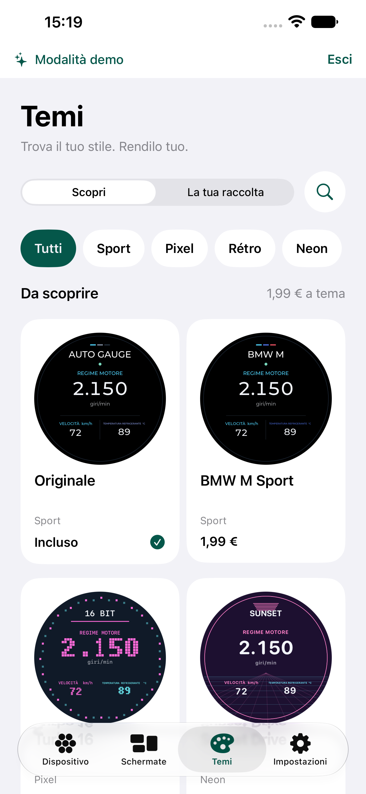
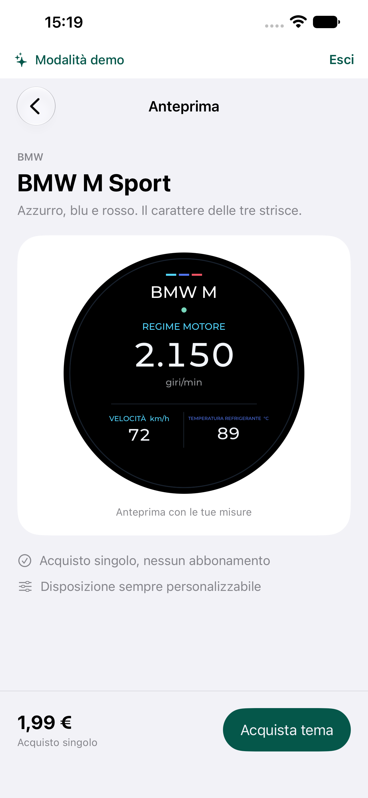
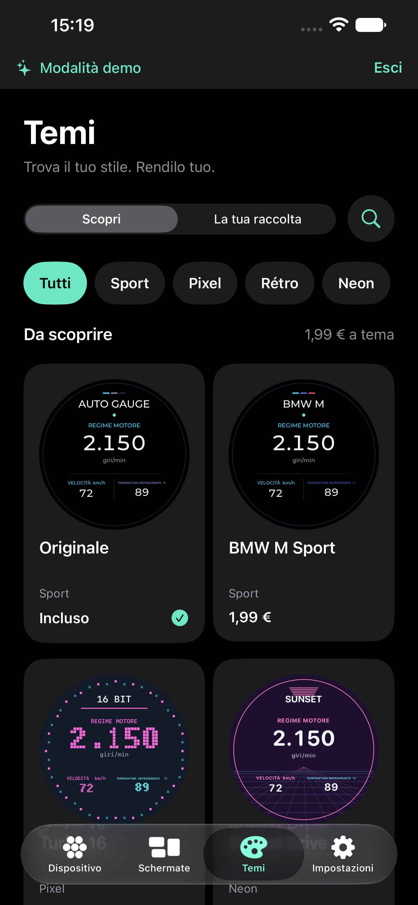
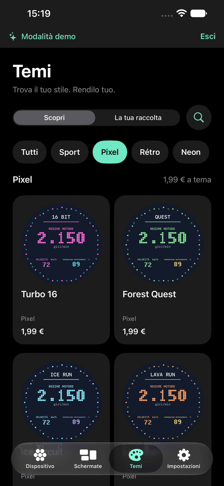
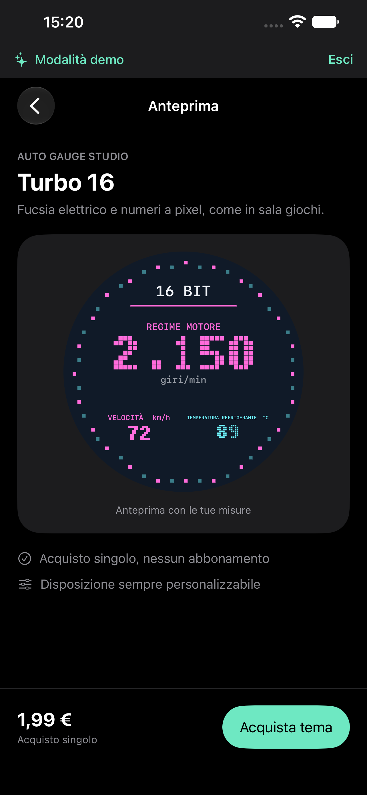

# Marketplace e superfici — 25 ottobre 2026

Revisione richiesta: rendere più chiari catalogo e acquisto, uniformando sfondi e colori dell’interfaccia. Le palette sportive restano confinate al quadrante. Prezzo iniziale approvato: 1,99 € per tema; anteprima gratuita.

1. **Catalogo — navigazione per stile.** Eliminati ricerca permanente e pulsanti dalla barra superiore. Il contenuto inizia da Temi, poi Scopri/La tua raccolta, accesso compatto alla ricerca e categorie orizzontali. La ricerca apre una pagina dedicata; creazione gratuita e ripristino sono nella raccolta, con etichette esplicite. Griglia standard a due colonne, una con caratteri di accessibilità. Le prime righe alternano sport e stili originali per mostrare la varietà.
2. **Anteprima e acquisto — azione unica.** Titolo, descrizione breve e quadrante precedono un riepilogo fisso con prezzo e un solo pulsante. La visibilità della barra inferiore dipende dal percorso di navigazione, per non sovrapporla al riepilogo. A caratteri grandi il riepilogo diventa verticale. In demo il percorso è una simulazione locale.
3. **Superfici e varietà — ruoli separati.** Sfondo chiaro #F2F2F7, pannelli bianchi; sfondo scuro nero, pannelli #1C1C1E. Le Form native e le schede condividono le stesse superfici. I temi possono avere fondi avorio, grafite o blu dentro il quadrante: i colori dell’app restano coerenti. Dieci famiglie cambiano cornici, texture, scale e font. Pixel e arcade disegnano i numeri come bitmap 5×7, senza antialiasing del font.

Le schermate `before/30-marketplace-before.png` e `before/31-purchase-before.png` sono state catturate e ispezionate durante questa revisione, prima delle modifiche. I quadranti seguono il layout Waveshare già validato in [CLUSTER27](../CLUSTER27/README.md).

## Ambito dei temi

60 temi totali: Originale incluso, 19 interpretazioni sportive e 40 creazioni Studio. Creatore personale gratuito. Le linee sportive sono: BMW M, Mercedes AMG, Audi RS, Porsche GT3, Ferrari Scuderia, Lamborghini STO, Alfa Quadrifoglio, Volkswagen R, Hyundai N, Toyota GR, Nissan Nismo, Honda Type R, MINI JCW, Alpine R, Lexus F, Ford Performance, Cupra VZ, Abarth, McLaren. Sono interpretazioni grafiche, senza loghi ufficiali o dichiarazioni di affiliazione. Riferimenti primari di colore/stile consultati: [BMW M](https://www.bmw-m.com/en/topics/magazine-article-pool/die-geschichte-des-bmw-m-logos.html), [Mercedes AMG](https://www.mercedes-benz.de/passengercars/mercedes-amg.html), [Audi RS](https://uploads.audi-mediacenter.com/system/production/uploaded_files/15878/file/b1d88632d3d98a1d5e5a281460e22fadd7233567/en_BasisInfo_RS_6_Avant.pdf), [Porsche](https://nieuws.porsche.nl/over-groene-porsches-en-andere-cultkleuren/). Le altre palette sono scelte progettuali, non specifiche ufficiali dei marchi.

## Indicazioni consultate

Scelte progettuali derivate dalle linee guida Apple: [Collections](https://developer.apple.com/design/human-interface-guidelines/collections) raccomanda griglie standard e spazio fra gli elementi; [Search fields](https://developer.apple.com/design/human-interface-guidelines/search-fields) descrive ricerca contestuale e filtri; [Toolbars](https://developer.apple.com/design/human-interface-guidelines/toolbars) raccomanda pochi comandi con significato chiaro. Qui la ricerca resta accessibile accanto alla scelta del catalogo, ma il campo compare nella pagina dedicata; le categorie evitano di dover digitare per esplorare 60 elementi. È una scelta applicata al prodotto, non un layout prescritto da Apple.

## Acquisti e limiti verificabili

In demo, aggiunta e selezione persistono in uno spazio separato e non producono addebiti o diritti reali. Nessun testo demo viene ripetuto nelle schede: resta il banner globale. Il client nativo StoreKit usa prodotti non consumabili, transazioni verificate, ripristino e aggiornamenti dei diritti; il gate `AutoGaugeThemePurchasesEnabled` resta **false**. Per vendere occorrono prodotti App Store Connect configurati e consegna del tema al display fisico: il protocollo BLE corrente non trasporta questa proprietà. La scelta cambia le anteprime dell’app, non il firmware.

Il catalogo locale `Config/Themes.storekit` è rigenerabile da `scripts/generate_theme_store.py`; non attiva vendite reali e non viene abilitato automaticamente nello schema. Documentazione primaria: [StoreKit](https://developer.apple.com/documentation/storekit/in-app-purchase), [diritti verificati](https://developer.apple.com/documentation/storekit/transaction/currententitlements).

Le immagini dimostrano gerarchia e superfici, non piena conformità di accessibilità. I controlli hanno etichette accessibili e le dimensioni grandi hanno layout dedicati; restano da valutare manualmente lettura VoiceOver completa, percezione dei colori e uso prolungato. I testi dentro il quadrante mantengono la scala fisica dell’anteprima; le informazioni della scheda restano separate e leggibili.

## Esito e immagini

I tre passaggi sono stati verificati sul simulatore iPhone 13 Pro Max con iOS 27: catalogo navigabile, acquisto demo con selezione persistente, superfici coerenti in entrambi gli aspetti. Nel controllo visivo finale è stato corretto anche il testo sui filtri e sull’azione principale: scuro sul verde chiaro in modalità scura, chiaro sul verde profondo in modalità chiara.

Verifiche: 201 test GaugeCore, 10 test AppModel e 11 test UI passati (`/tmp/ag-themes60-core.log`, `/tmp/ag-themes60-model.log`, `/tmp/ag-themes60-ui.log`). Dopo l’ultima correzione di contrasto è stato ripetuto il percorso visivo catalogo/anteprima, chiaro/scuro e Pixel. La build iPhone firmata è stata installata; il telefono bloccato impedisce l’avvio automatico. Nessuna transazione reale o consegna al display è stata eseguita. Il simulatore principale è aggiornato separatamente da quello dei test. Le immagini accettate e le loro fonti sono elencate in `screenshots.json`.
